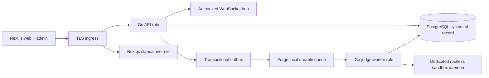

# Judgify

Judgify is a single-tenant online judge for DSA practice, programming contests,
reproducible code evaluation, learning content, and cultivation-style learner
progression. The public product and administration console share one typed API,
one authorization model, and one realtime WebSocket transport.

## Product capabilities

- Versioned problems, taxonomy, statements, test groups, immutable testsets,
  checker profiles, language runtimes, publication, archive, and rollback.
- Idempotent submissions, durable jobs/attempts/judgements, isolated execution,
  capability-aware workers, cancellation/rejudge, and realtime verdict updates.
- Contest registration, announcements, clarifications, standings, rating runs,
  rerating, participant visibility rules, and replayable realtime updates.
- Password and OAuth authentication, protected browser sessions, recovery-contact
  lifecycle, session/device management, audit history, and Ent-backed Casbin
  role/policy administration.
- Learning materials with versioned render artifacts, publication lifecycle,
  search, related content, and privacy-safe view accounting.
- Server-owned cultivation catalogs, durable onboarding trait offers, immutable
  reward facts, progression, rankings, and administrative catalogs.
- Notification inbox/campaigns, operational controls, health/readiness, bounded
  metrics, correlation-aware logs, encrypted backup/restore, and N/N-1 rollout.

All browser-facing Vietnamese copy is centralized so another locale can be
introduced without rewriting components. Light, dark, and system themes use the
same tokenized design system across public and admin routes.

## Architecture



The backend is a modular monolith with explicit API, worker, and migration
roles. PostgreSQL is canonical; Forge is a single-host durable accelerator and
can be rebuilt/reconciled from canonical state. API processes never receive a
Docker socket. Browser realtime uses short-lived authenticated tickets,
bounded queues, replay cursors, and resynchronization rather than SSE or network
polling.

## Technology

- Go 1.27.1, Gin, Ent, Casbin with the Ent adapter, PostgreSQL 16
- Next.js 16, React 19, TypeScript, Tailwind CSS 4
- `go-common` lifecycle, health, security, observability, WebSocket, outbox, and
  Forge packages
- Docker/Compose for local and single-host production topology

Only focused packages are imported from the sibling `go-common` module. Local
development uses the sibling working tree; release source must reference an
immutable published version and contain no filesystem replace.

## Repository layout

```text
api/        Go commands, domain modules, Ent schema, and migrations
website/    Public/admin Next.js application and browser contracts
docker/     Reproducible API, worker, website, migrator, and sandbox images
deploy/     Single-host production topology, role bootstrap, and runbook
scripts/    Migration, verification, backup, restore, rollout, and smoke tools
test/       Load, chaos, rollout, and backup/restore evidence scenarios
docs/       Architecture guides plus approved design and execution plans
```

## Local development

Prerequisites are the pinned Go and Node versions, Docker with Compose/Buildx,
Atlas for schema authoring, and a sibling `../go-common` checkout.

```sh
make dev-bootstrap
make docker-up
make migrate-apply
make run-api
make run-website
```

`make dev-bootstrap` creates git-ignored, mode-restricted local database/JWT
secrets and a 3072-bit RSA key pair without printing secret values. The local
API exposes the code-owned runtime/checker authoring catalog, but that catalog
has no executable image identity and cannot start a judge worker. Running a
worker still requires an explicitly reviewed release manifest, a digest-pinned
sandbox image, and a dedicated rootless Docker daemon as documented for the
single-host deployment.

Run `make seed` only when deterministic local catalog fixtures are wanted. It
is never part of production startup. Local configuration lives in
`api/config/local.yaml`; production uses operator-owned, file-backed secrets and
the templates under `deploy/`.

## Verification and release

Focused checks are available through the component Make targets. The canonical
full gates are:

```sh
make verify
make verify-integration
make verify-release
```

Integration and release commands intentionally fail unless their isolated
drivers, acknowledgements, immutable image inventory, coverage floor, and
external evidence directories are supplied. CI, destructive integration, and
unsigned release-evidence workflows use separate permission and runner trust
boundaries.

Production is not started with the local Compose file. Follow
[`deploy/README.md`](deploy/README.md) for topology, release manifest approval,
database roles, rootless sandboxing, probes, backup/restore, deployment, and
rollback.

## Project guides

- [`docs/BACKEND_GUIDE.md`](docs/BACKEND_GUIDE.md)
- [`docs/FRONTEND_GUIDE.md`](docs/FRONTEND_GUIDE.md)
- [`SECURITY.md`](SECURITY.md)
- [`CONTRIBUTING.md`](CONTRIBUTING.md)

Judgify is licensed under the [MIT License](LICENSE).
